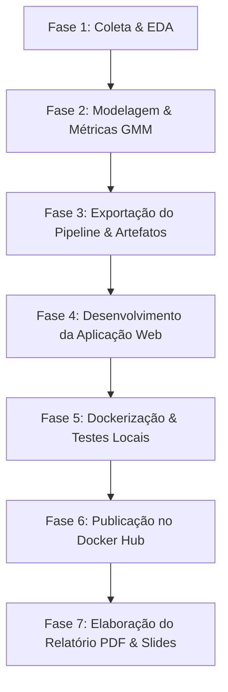

# Documento de Requisitos do Produto (PRD) & Plano de Implementação
**Projeto:** Aplicação de Clusterização com Misturas Gaussianas (GMM) em Container Docker  
**Disciplina:** Mineração de Dados — UNITINS (Sistemas de Informação)  
**Grupo 5:** Daniel, Vladmir, Nedson, Paulo Henrique  
**Algoritmo:** Misturas Gaussianas (Gaussian Mixture Models - GMM)  
**Dataset:** [Rice (Cammeo and Osmancik)](https://archive.ics.uci.edu/dataset/545/rice+cammeo+and+osmancik)  
**Prazo Limite:** 16/11/2026 até às 18:00h  

---

## 1. Visão Geral e Objetivos do Projeto

### 1.1 Objetivo
Desenvolver, avaliar e disponibilizar em ambiente conteinerizado (Docker) um pipeline completo de Machine Learning não supervisionado focado em clusterização com **Misturas Gaussianas (GMM)** aplicado ao conjunto de dados de grãos de arroz (*Cammeo* e *Osmancik*), contendo interface interativa para inferência em tempo real e documentação técnica completa.

### 1.2 Entregáveis Obrigatórios
1. **Relatório Técnico em PDF**:
   - Descrição do problema de negócio/domínio;
   - Análise Exploratória dos Dados (EDA);
   - Justificativa da escolha do algoritmo (GMM) e hiperparâmetros (BIC/AIC, covariâncias);
   - Métricas de avaliação de clusters (Silhueta, Davies-Bouldin, Calinski-Harabasz, Matriz de Contingência/Pureza com classes reais);
   - Interpretação semântica dos clusters encontrados;
   - Capturas de tela (prints) da aplicação em execução e do container Docker rodando localmente;
   - Link público do repositório no Docker Hub.
2. **Código-Fonte do Projeto**:
   - Notebook/scripts de treinamento e validação;
   - Backend e Frontend organizados e comentados.
3. **Dockerfile Funcional**:
   - Construção otimizada, reprodutível e pronta para execução em qualquer máquina com Docker.
4. **Link do Repositório Docker Hub**:
   - Imagem pública disponível para `docker pull` e `docker run`.
5. **Preparação para Apresentação**:
   - Duração máxima de 10 minutos (qualquer membro do grupo poderá ser sorteado pelo professor).

---

## 2. Detalhes do Algoritmo e do Dataset

### 2.1 Dataset: Rice (Cammeo and Osmancik)
- **Origem:** UCI Machine Learning Repository (ID 545).
- **Instâncias:** 3.810 registros (Cammeo: 1.630, Osmancik: 2.180).
- **Atributos (7 morfológicos contínuos):**
  1. `Area`
  2. `Perimeter`
  3. `Major_Axis_Length`
  4. `Minor_Axis_Length`
  5. `Eccentricity`
  6. `Convex_Area`
  7. `Extent`
- **Variável Alvo Original (para validação cruzada externa/pureza):** `Class` (Cammeo / Osmancik).

### 2.2 Algoritmo: Misturas Gaussianas (GMM)
- **Paradigma:** Probabilístico (Soft Clustering / Fuzzy). Modela os dados como uma sobreposição de distribuições normais multivariadas com médias e matrizes de covariância estimadas via algoritmo de Expectativa-Maximização (EM).
- **Vantagens para este dataset:** Grãos de arroz possuem variações biométricas contínuas em formato elíptico, tornando distribuições gaussianas com covariância flexível (`full` ou `tied`) muito mais adequadas do que métodos baseados puramente em distâncias esféricas euclidianas como K-Means.

---

## 3. Arquitetura da Solução Técnica

A solução será unificada e leve para facilitar empacotamento em um único container Docker ou multi-serviço:

- **Linguagem & Ambiente de Modelagem:** Python 3.10+ com Jupyter Notebook, `scikit-learn`, `pandas`, `seaborn`, `matplotlib`.
- **Framework Web (Aplicação):**
  - **Opção Recomendada (All-in-one):** **Streamlit**. Unifica frontend moderno, entrada de formulário para os 7 parâmetros, gráficos interativos de probabilidade/densidade gaussiana e inferência no mesmo container de forma extremamente rápida e robusta.
  - *(Alternativa)*: FastAPI no Backend + HTML/Tailwind/JS simples servido staticamente.
- **Artefatos Salvos:**
  - `scaler.pkl`: Pré-processador (ex: `StandardScaler` ou `MinMaxScaler`).
  - `gmm_model.pkl`: Modelo GMM treinado e calibrado.
- **Containerização:** Dockerfile multi-stage ou single-stage enxuto baseado em `python:3.10-slim`.

---

## 4. Plano de Implementação Passo a Passo

### Fase 1: Análise Exploratória dos Dados (EDA)
- [ ] Baixar os dados do UCI Repository (`arff` ou `.xlsx`/`.csv`).
- [ ] Carregar no Jupyter Notebook e inspecionar tipos de dados e shape (3810 x 8).
- [ ] Verificar e comprovar ausência de valores nulos/faltantes.
- [ ] Gerar estatísticas descritivas (média, mediana, desvio padrão, min, max, assimetria).
- [ ] Plotar histogramas e KDEs das 7 variáveis numéricas para comprovar o comportamento gaussiano/multimodal.
- [ ] Matriz de correlação (heatmap) e pairplot para visualização de dispersão.

### Fase 2: Pré-processamento e Modelagem com GMM
- [ ] Normalização dos dados com `StandardScaler` (essencial para GMM lidar com diferentes ordens de grandeza geométrica).
- [ ] Estudo de número de componentes ($K=2$ a $K=6$) utilizando métricas de informação:
  - **BIC** (Bayesian Information Criterion);
  - **AIC** (Akaike Information Criterion).
- [ ] Ajuste do modelo ótimo com `GaussianMixture(n_components=2, covariance_type='full', random_state=42)`.
- [ ] Avaliação Não Supervisionada:
  - Coeficiente de Silhueta (Silhouette Score);
  - Índice Davies-Bouldin;
  - Índice Calinski-Harabasz.
- [ ] Análise Comparativa Externa (Ground Truth vs Clusters previstos):
  - Matriz de Confusão / Contingência;
  - Pureza dos clusters;
  - Análise de probabilidades atribuídas (probabilidade de pertencer a cada componente).

### Fase 3: Desenvolvimento da Aplicação Web
- [ ] Criar a interface de inferência:
  - Entradas: 7 sliders ou caixas numéricas com limites pré-definidos pelos mínimos e máximos reais do dataset.
  - Botão de predição: "Classificar Grão".
  - Resultados:
    - Cluster atribuído (Cluster 0 ou Cluster 1);
    - Probabilidade associada a cada cluster (ex: 85% Componente 0, 15% Componente 1);
    - Interpretação do perfil do grão (ex: "Tendência morfológica: Grão mais longo/fino vs Grão mais arredondado");
    - Gráfico interativo destacando a nova amostra em relação aos dados conhecidos (ex: PCA ou Projeção 2D).

### Fase 4: Conteinerização com Docker
- [ ] Criar `requirements.txt` com versões fixadas (`streamlit`, `scikit-learn`, `pandas`, `numpy`, `joblib`, etc.).
- [ ] Escrever `Dockerfile`:
  - Imagem base leve (`python:3.10-slim`).
  - Cópia do código e modelos salvos.
  - Exposição de porta (ex: 8501).
  - Healthcheck e comando de inicialização.
- [ ] Testar build local: `docker build -t rice-gmm-app:latest .`
- [ ] Testar execução local: `docker run -p 8501:8501 rice-gmm-app:latest`.
- [ ] Tirar prints dos comandos e do container rodando (Desktop Docker / terminal).

### Fase 5: Publicação no Docker Hub
- [ ] Efetuar login no Docker Hub via CLI: `docker login`.
- [ ] Marcar tag com o repositório público: `docker tag rice-gmm-app:latest <usuario_dockerhub>/rice-gmm-cluster:latest`.
- [ ] Enviar a imagem: `docker push <usuario_dockerhub>/rice-gmm-cluster:latest`.
- [ ] Testar o pull em ambiente limpo: `docker pull <usuario_dockerhub>/rice-gmm-cluster:latest`.
- [ ] Registrar o link público para entrega.

### Fase 6: Confecção do Relatório Final (PDF) e Apresentação
- [ ] Estruturar o documento com todos os itens obrigatórios:
  1. Introdução e contextualização do problema e dataset;
  2. EDA completa com gráficos e interpretações;
  3. Metodologia: fundamentação teórica de Misturas Gaussianas e critério BIC/AIC;
  4. Resultados obtidos e métricas (Silhueta, Davies-Bouldin, etc.);
  5. Demonstração da aplicação (prints de telas de inferência);
  6. Demonstração do Docker (Dockerfile, prints de `docker ps`, link do Docker Hub);
  7. Conclusões.
- [ ] Gerar versão final em PDF.
- [ ] Preparar tópicos de fala (roteiro de 10 min) para todos os integrantes estarem aptos a apresentar.

---

## 5. Cronograma Recomendado

| Horário Estimado | Tarefa | Responsáveis Sugeridos |
|---|---|---|
| **15:30 - 16:15** | Download do dataset, EDA e treinamento do modelo GMM no Jupyter | Daniel & Vladmir |
| **16:15 - 16:50** | Construção da aplicação web (Streamlit) e exportação dos modelos | Nedson & Vladmir |
| **16:50 - 17:15** | Construção do Dockerfile, teste local e push no Docker Hub | Paulo Henrique & Daniel |
| **17:15 - 17:50** | Coleta de prints, redação do Relatório Técnico e exportação para PDF | Todo o Grupo |
| **17:50 - 18:00** | Revisão final dos links, submissão da atividade e alinhamento de fala | Todo o Grupo |

---

## 6. Critérios de Sucesso
- [x] Execução da aplicação sem falhas locais e conteinerizada.
- [x] Predição com suporte a inferência probabilística em tempo real.
- [x] Repositório público no Docker Hub funcional com comando de execução claro.
- [x] Relatório completo contendo todas as seções e prints exigidos.

